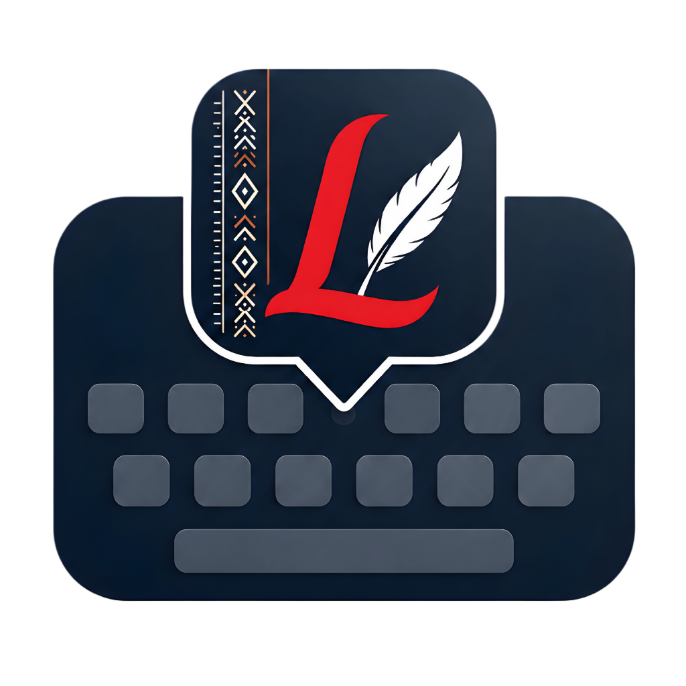

<p align="center">
  
</p>

<h1 align="center">Likhibi</h1>

<p align="center"><strong>Nagamese, written by its people.</strong><br>
A keyboard, an offline translator and an open, consent-based record of everyday Nagamese.</p>

---

*Likhibi* means "please write". Nagamese is the language Nagas of different tribes use with each other: in the market, in church, on the phone, and in chats every day. It still has no keyboard that knows its words, no translator that works without internet, and almost no open text outside the Bible.

Likhibi does three things:

1. **Write.** An Android keyboard that suggests real Nagamese words as you type. Prediction runs on the phone, and what you type never leaves it.
2. **Bridge.** English and Nagamese translation in both directions inside the keyboard, with no internet. When there is a connection, a stronger model on a laptop server can answer instead.
3. **Keep.** A web dashboard where speakers correct translations and add the sentences they actually say. Each contributor chooses how their words are shared, a second speaker checks every contribution, and an approved sentence improves the translator on the very next request.

## Community, consent and ownership

- **Speakers own what they contribute.** Each contributor chooses between publishing openly under CC BY-SA 4.0 and keeping the sentence inside Likhibi only, and between being credited by name and staying anonymous. A contribution is removed from Likhibi when its contributor asks.
- **Nothing is scraped.** Every word and sentence comes from an openly licensed source or from a person who chose to share it. The [lexicon card](datasets/processed/lexical_database/LEXICON_CARD.md) gives the source of every one of its 6,912 words.
- **Nothing is sold.** The models are trained from non-commercial and share-alike material, and they stay that way.
- **Privacy by default.** Keyboard prediction and offline translation never send data anywhere. The keyboard never learns from password or incognito fields. Online translation happens only when the user taps Online or switches it on in Settings, and only the sentence they choose is sent.
- **It keeps running without us.** The models run on a phone and a laptop with no cloud bill, and the dataset and code are open.

## Results

Every number below is measured on New Testament books that no model saw in training: 1, 2 and 3 John, Titus, Philemon and Jude.

**Translation** (chrF++, with BLEU in brackets; higher is better)

| Model | Where it runs | English → Nagamese | Nagamese → English |
| --- | --- | --- | --- |
| NLLB-200 600M, fine-tuned with LoRA | Laptop GPU, 2.4 GB | **47.19** (19.45) | **57.46** (41.12) |
| Distilled phone model, 21M parameters, int8 | Inside the keyboard, 27.7 MB | **43.93** (16.14) | **36.81** (14.24) |
| Baseline: copy the most similar training verse | | 27.20 | 23.40 |

Off the shelf, NLLB has no Nagamese and writes Tok Pisin instead, scoring about 13 chrF++ on the dev books. The phone model keeps 93% of the large model's score into Nagamese at an 87th of its size, and translates a sentence in about 45 ms on a laptop CPU.

**Keyboard** (typing simulation on the held-out books, with three suggestions shown)

| Measure | Value |
| --- | --- |
| Keystrokes saved by suggestions | **59.0%** |
| Intended word shown after the first letter | 31.9% |
| Next word among the suggestions before any letter | 35.7% |
| Perplexity: Kneser-Ney trigram, against add-k bigram and trigram baselines | **57.0**, against 74.8 and 187.0 |

**Lexicon:** 6,912 words, 3,029 of them found in real text, 3,408 curated by people and 475 waiting for a speaker. Universal POS tags cover 90.9% of running text, with verb morphology and 243 spelling-variant groups.

**Known limits.** The only open parallel text in Nagamese is the New Testament, so today the models write in a scripture register and are weaker on everyday sentences. There is no everyday test set yet; the dashboard builds one from verified contributions. Meanings in the lexicon are candidates until a speaker confirms them. This is what the Keep part exists to fix.

## How it works

**Keyboard** (`app/`, Kotlin)
- A character trie over the lexicon, and an interpolated modified Kneser-Ney trigram language model. Its discounts are estimated from counts of counts, and its tables are pruned per context with renormalised backoff, so the phone keeps a proper probability distribution in about 3.4 MB.
- An everyday-word prior, user learning on the phone, and capitalisation of names learned from text (Kohima, Khrista).
- A translate bar with a live preview, Insert and Undo. It runs the distilled model through ONNX Runtime, with a pure-Kotlin SentencePiece tokenizer. Unit tests check that the Kotlin tokenizer and decoder match the Python reference.
- Themes, wallpapers, haptics and clipboard history, in the Naga Heritage palette.

**Translation engines** (`nlp_research/translation/`, Python). All of them sit behind one contract (`engine_api.py`):
- **Translation memory:** exact and near matches, with speakers' approved corrections first.
- **LLM with retrieved examples:** an LLM shown the 24 most similar sentence pairs plus glossary hints. It needs a Gemini key or any OpenAI-compatible server.
- **Fine-tuned NLLB-200** with LoRA, offline on the laptop.
- **Phone model:** a Marian transformer distilled from the NLLB model on about 100,000 everyday English sentences from Tatoeba, plus the training verses. It is exported to ONNX at int8, and is exactly what the keyboard runs.

**Dashboard** (`dashboard/`, FastAPI with React)
- **Home:** the live community counter.
- **Translate:** compares engines, shows why a translation was chosen, and takes ratings.
- **Contribute:** teach Likhibi a sentence or a meaning, with the consent choice.
- **Review:** a second speaker checks each contribution.
- **Language data:** every source with its licence.
- **Engines:** the status of each engine.
- **Evaluation:** every scored run, weakest sentences first.

## Repository

```
app/            Android keyboard (IME) with offline prediction and translation
dashboard/      Web dashboard: backend/ (FastAPI, SQLite) and frontend/ (React, TypeScript, Tailwind)
nlp_research/
  corpus/       Builds the aligned English–Nagamese corpus from USFM sources
  lexicon/      Builds the lexicon with provenance, POS tags, morphology and variants
  prediction/   Kneser-Ney model, keyboard asset builder and typing simulation
  translation/  Engines, NLLB fine-tuning, distillation, ONNX export and evaluation
  tests/
datasets/
  raw/          Source texts (USFM) and curated word lists
  processed/    Parallel corpus, dev and test sets, lexicon, keyboard models
  evaluations/  Scored runs shown on the dashboard's Evaluation page
docs/RUNBOOK.md Running the live demo and the data drive at an event
tools/make_qr.py QR card that links visitors to the Contribute page
```

## Run it

**Keyboard.** Use Android Studio's JDK (JBR) and the Android SDK. Connect a phone with USB debugging on, then run:

```powershell
.\gradlew :app:installDebug          # or assembleDebug: app\build\outputs\apk\debug\app-debug.apk
.\gradlew :app:testDebugUnitTest     # prediction assets and Kotlin/Python parity tests
```

On the phone, open Likhibi, then choose Enable Keyboard and Select Keyboard. The build is arm64 only by default; add `-Plikhibi.allAbis=true` for emulators.

**Dashboard.** Needs Python 3.10 or newer and Node.js 20.19 or newer.

```powershell
cd dashboard\backend
python -m venv .venv
.venv\Scripts\python -m pip install -r requirements-dev.txt
.venv\Scripts\python -m uvicorn app.main:create_app --factory --reload --port 8000

cd ..\frontend            # in a second terminal
npm install
npm run dev               # http://localhost:5173
```

This serves the translation memory and the LLM engine. The NLLB and phone-model engines run from the ML environment below. [`dashboard/README.md`](dashboard/README.md) covers configuration, saving an API key, and connecting new engines.

**ML environment**, for training and serving the models:

```powershell
python -m venv C:\likhibi-ml
C:\likhibi-ml\Scripts\python -m pip install torch==2.14.1 --index-url https://download.pytorch.org/whl/cu126
C:\likhibi-ml\Scripts\python -m pip install -r nlp_research\requirements-ml.txt -r dashboard\backend\requirements.txt
```

Rebuild everything from the sources, from the repository root:

```powershell
python -m nlp_research.corpus.build_bible_parallel               # aligned corpus and held-out splits
python -m nlp_research.lexicon.build_lexicon                     # lexicon (needs NLTK's tagger data)
python -m nlp_research.prediction.build_keyboard_assets          # keyboard trie and Kneser-Ney tables
python -m nlp_research.prediction.build_keyboard_assets --holdout
python -m nlp_research.prediction.evaluate_keyboard              # typing simulation
python -m nlp_research.translation.train_nmt --epochs 3          # NLLB + LoRA, about 45 min on a 4 GB GPU
python -m nlp_research.translation.distill prepare               # needs Tatoeba's eng_sentences.tsv.bz2 in datasets\raw\monolingual\tatoeba_eng\
python -m nlp_research.translation.distill generate              # the NLLB model translates them
python -m nlp_research.translation.distill kd                    # the NLLB model re-translates the training verses
python -m nlp_research.translation.distill train --kd --d-model 384 --ffn 1536 --minutes 160
python -m nlp_research.translation.export_student --student-dir models\student   # ONNX int8, copied into the app
python -m pytest nlp_research\tests dashboard\backend\tests
```

Score any engine on a test set (the run appears on the Evaluation page):

```powershell
python -m nlp_research.translation.evaluate_engine --engine nlp_research.translation.engines.student:StudentEngine `
    --test-set datasets\processed\test_sets\bible_heldout_test_en_nag.tsv --direction en-nag --test-set-name bible-heldout-test
```

## Data and licences

| Material | Source | Licence |
| --- | --- | --- |
| Nagamese New Testament | *Indian Standard Version (ISV) Nagamese*, © 2019 Bridge Connectivity Solutions, via [eBible.org](https://ebible.org/Bible/details.php?id=nag) | CC BY-SA 4.0 |
| English New Testament | *World English Bible*, via [eBible.org](https://ebible.org/Bible/details.php?id=engwebp) | Public domain |
| Everyday English sentences | [Tatoeba](https://tatoeba.org) | CC BY 2.0 FR |
| Base translation model | Meta's [NLLB-200 distilled 600M](https://huggingface.co/facebook/nllb-200-distilled-600M) | CC BY-NC 4.0 |
| Community contributions | Speakers, through the dashboard | CC BY-SA 4.0 or Likhibi only, as each contributor chooses |

Everything derived from the Nagamese text is shared under CC BY-SA 4.0: the corpus, the lexicon and the keyboard models. The translation models also inherit NLLB's non-commercial terms. The [corpus card](datasets/processed/parallel_corpus/README.md) lists every change made to the source texts.
